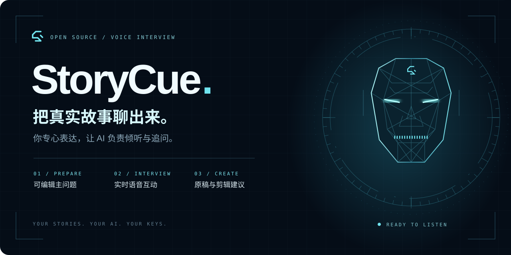
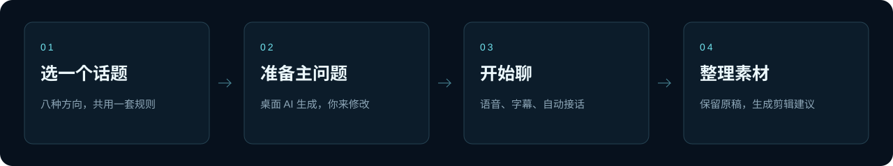
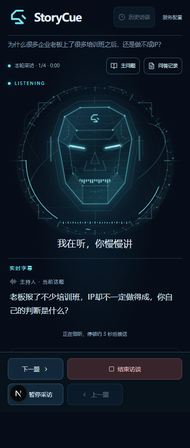
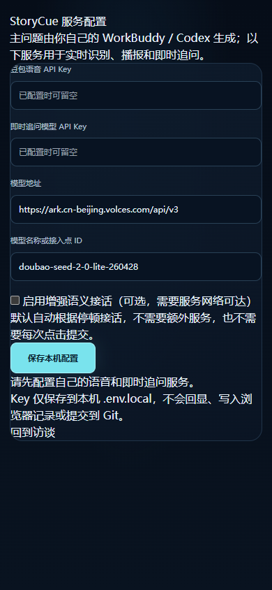
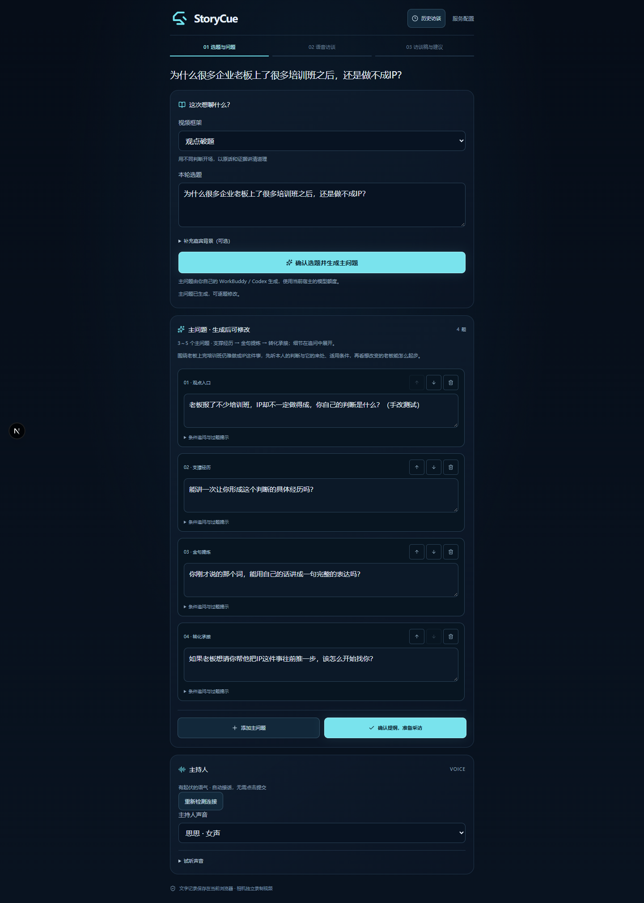

<p align="center"></p>

<p align="center"><strong>一个人拍视频，也能有人认真追问。</strong><br/>从一个选题，到一场有细节的对话，再到可整理的视频素材。</p>

<p align="center"><a href="#安装与启动">快速开始</a> · <a href="#界面预览">界面预览</a> · <a href="#用-workbuddy--codex-生成主问题">桌面 AI</a> · <a href="#不使用-jev-也能采访">自动接话</a> · <a href="#当前边界">当前边界</a></p>

---

## 为真实表达而做

StoryCue 是面向短视频创作者、采访者与个人 IP 的开源语音访谈工具。你准备一个选题，它帮你搭起采访动线：生成少量主问题、承接回答追问、显示实时字幕，结束后保留访谈稿，并给出与视频方向一致的剪辑建议。

**相机负责拍摄。你负责表达。StoryCue 负责把话聊下去。**



| 核心体验 | 它如何帮助拍摄 |
| --- | --- |
| **少量问题，留出深聊的空间** | 默认生成 3–5 个主问题；支撑、经历、关键词与自然承接进入同一条动线，细节在追问中展开。 |
| **有状态的语音界面** | 贾维斯风格全息头像，配合倾听、思考、提问与暂停；同步显示当前问题和字幕。 |
| **自动接话** | 不启用增强语义服务也会在停顿后自动接话，无需每次点提交；继续讲话会延后。 |
| **你的 AI，你的选择** | 主问题通过已连接的本机 WorkBuddy/CodeBuddy 或 Codex 官方 CLI 自动生成并回填；不使用发布者账号。 |
| **原稿与建议放在一起** | 保留分轮问答、手动改题和文字导出；建议引用本轮已确认段落，缺少支撑时提示补拍。 |
| **四个主持人声音** | 思思、Vivi、刘飞、小何；支持有起伏的说话语气。语音服务使用用户自己的配置。 |

## 界面预览

以下是本地实测截图。示例选题与回答用于功能验证，不代表真实客户采访或业务成果。

<table>
  <tr><td width="50%" align="center"><strong>倾听，把舞台留给表达者</strong></td><td width="50%" align="center"><strong>自备服务，配置清楚可见</strong></td></tr>
  <tr><td valign="top" align="center"></td><td valign="top" align="center"></td></tr>
</table>

<details>
  <summary><strong>展开桌面端提纲与工作区实拍</strong></summary>
  <br/>
  
</details>

## 八种视频方向，一套连贯的方法

不同方向会改变问题的入口、追问重点和剪辑建议。它们共用同一份定义，不只是换一个标题。

| 方向 | 采访要聊出的内容 |
| --- | --- |
| **观点破题** | 本人的判断、形成依据、真实经历与适用边界。 |
| **四维信任** | 破圈、人设、专业与转化，以具体内容建立可信度。 |
| **方法直给** | 从哪里开始、具体怎么做、输入与产物、判断标准。 |
| **痛点解答** | 真实场景里的卡点、答案、依据和可行下一步。 |
| **情绪共鸣** | 一个真实瞬间、一句话、一个动作和当时的感受。 |
| **人物故事** | 与选题有关的选择、行动、转折和变化。 |
| **现场探访** | 客户关心的看点、可拍细节与现场标准；口述与实拍分开。 |
| **决策问答** | 选择前的疑虑、比较依据、服务条件与不适用边界。 |

采访不限于十分钟。主问题可以手动改，故事不会为了凑框架被预写。

## 安装与启动

需要 Node.js 20.9+、npm、可访问所选模型/语音服务的网络。

```sh
git clone https://github.com/msaysay/storycue.git
cd storycue
npm ci
# 在 WorkBuddy 中安装时：
npm run desktop:connect -- --host workbuddy
# 在 Codex 中安装时，把上一行改为 --host codex
npm run desktop:doctor
# 若提示未登录，先 desktop:login，再重新 desktop:doctor
npm run dev
```

打开 [本机配置页](http://127.0.0.1:3066/trial/setup)，分别配置下面两套服务。**豆包语音与即时追问可以使用不同服务商；页面的文本 Base URL 不控制语音服务。**

| 配置部分 | 用来做什么 | 地址与凭据 |
| --- | --- | --- |
| **豆包语音** | 识别回答、把主持人的问题读出来 | ASR/TTS 地址已内置，用户只需填写自己的豆包语音 API Key，并开通识别和合成权限。 |
| **即时追问文本模型** | 根据回答继续追问、生成剪辑建议 | 自行选择快速文本模型，填写该服务商配套的 **Base URL + API Key + 模型名/接入点 ID**，不要求使用豆包文本模型。 |
| **桌面 AI** | 默认生成 3–5 个主问题 | 使用 WorkBuddy/Codex 当前宿主的模型能力，无需在网页填写主问题模型 Key。 |

豆包语音固定识别地址为 `wss://openspeech.bytedance.com/api/v3/sauc/bigmodel`，合成地址为 `https://openspeech.bytedance.com/api/v3/tts/unidirectional`，两者不必手填。语音 Key 来自火山引擎语音服务，与火山方舟文本模型属于不同服务，权限和额度请分别核对。

即时追问使用 **OpenAI Chat Completions 兼容接口**：Bearer Key 认证、SSE 流式，以及 `messages` / `temperature` / `max_tokens` 参数；不是只要有任意模型 Key 就都兼容。只支持 Responses、Anthropic Messages 等其他协议，或不接受这些标准参数的模型，需要另行适配。优先选择低延迟、直接输出答案的模型，具体速度取决于服务、模型与网络。

**文本地址怎么填：** 填服务商文档中的 HTTPS API Base URL，保留其版本路径；例如示例方舟配置为 `https://ark.cn-beijing.volces.com/api/v3`，工具会请求其下的 `/chat/completions`。其他服务如果给出 `https://你的服务/v1`，就填这一基础地址；不要填控制台网址、聊天网页或再次附加 `/chat/completions`。模型名也要换成同一服务实际开通的名称，不要换了地址还沿用示例豆包模型名。

网页默认载入已保存的地址和模型名，Key 不回显。同服务留空保留 Key；切换文本服务地址时需填写新服务 Key，语音 Key 可以保持。`RELAY_LLM_THINKING=auto` 仅对内置方舟地址发送关闭思考参数，其他服务不发送豆包专用参数；不保证所有模型都能关闭思考。

保存后停止并重新运行 **StoryCue 启动器**；也可以把 `.env.example` 复制为 `.env.local` 后自行填写。发布包没有任何可用 Key，不读取作者电脑的凭据库、代理或服务器。

默认主问题由用户的桌面 AI 生成；实时语音识别、播报、即时追问和剪辑建议使用用户自己配置的 API，可能产生相应费用。主问题使用桌面 AI 的账号额度，不代表离线或免费。

## 用 WorkBuddy / Codex 自动生成主问题

**0.2.0 起，网页点生成会自动调用已连接的官方 CLI，不再要求每次返回聊天窗口发送任务指令。** 它调用的是本机官方客户端的模型能力，不是手机浏览器直接访问宿主，也不需要另填主问题 API Key。

首次安装只做一次：

1. 安装依赖 `npm ci`。在 WorkBuddy 安装时运行 `npm run desktop:connect -- --host workbuddy`；在 Codex 安装时用 `--host codex`。安装宿主应替用户执行这一步，不要省略。
2. 运行 `npm run desktop:login`，在官方 CLI 完成登录。**桌面 App 已登录不保证独立 CLI 已登录**；账号和额度以该 CLI 当前登录配置为准，不保证不同产品套餐自动互通。不读取、提取或复制桌面 App Token。
3. **必须运行 `npm run desktop:doctor` 做真实模型检查**，成功返回 `verified:true` 和 3–5 题数量后再启动 `npm run dev`。`desktop:status` 的 configured 仅表示文件存在，不能作为安装验收；verified 是最近 24 小时与当前配置匹配的实际调用记录，不保证后续网络或额度永远可用。
4. 网页输入选题、选择方向、点击“确认选题并生成主问题”。服务自动调用对应 CLI，严格检查方向和格式，自动回填 3–5 题；用户仍可手动修改、确认并开始采访。

**0.2.1 修复 WorkBuddy 内置精简入口误连接：** `npm ci` 会安装固定版本 `@tencent-ai/codebuddy-code@2.178.0`，优先连接项目内完整官方 CLI，不再自动使用 App 内置精简入口。CLI 作为外部依赖按其自身许可和服务条款提供，不包含登录凭据。即使 WorkBuddy 桌面窗口已经登录，独立 CLI 仍可能需要一次官方登录。连接、登录、生成使用相同的独立 CLI 配置，隔离桌面进程内部 profile / lite、SERVER__ 服务端口及 CLIENT_INFO 身份参数；需要自定义官方配置目录时显式传 `--config-dir <目录>`，不提取 App Token。

Codex 使用本机已安装的官方 CLI；支持 npm 包入口和原生可执行文件。连接配置仅存于本机 `.storycue-data/desktop-bridge.json`，不进入 Git。连接时从 CLI 支持列表选择快速模型，不修改桌面 App 全局设置；可用 `--model <支持的模型ID>` 或 `--cli <官方完整入口>` 显式指定。

调用经过 `pending → running → completed/failed` 状态。未连接直接提示接入方法，不创建无限等待任务；未登录、额度不足、CLI 版本不兼容、空输出、提纲不合格或超过 150 秒都会终止并明确提示。没有暗中改用 API 生成，不切换到另一个账号来源。主问题调用仅允许本机页面；手机/公网远程调用这层需要另加认证与受控代理。

**0.2.1 本轮验收：** 在原生 WorkBuddy 安装中复现精简入口、服务端口冲突和客户端身份变量干扰，并加入对应修复。完整官方 CLI 真实检查返回4题；带上述宿主变量的独立生产网页点击 → 模型生成 → 4题回填 → 手改 → 刷新保留通过，该次全流程约10秒。14项发布回归、20项相关开发回归及生产构建通过。原生 WorkBuddy 最终页面复验中止，仍待完成，不把独立网页测试当作原生完整验收。

**历史验收（0.2.0）：** Windows 本机已分别完成 Codex 与 WorkBuddy/CodeBuddy 的真实网页全链路：点击 → 官方 CLI 模型生成 → 四题自动回填 → 手动修改 → 刷新保留。WorkBuddy/CodeBuddy 使用官方 CLI 2.178.0、其列表支持的 `deepseek-v4.1-flash`，该次网页全流程约 21 秒；Codex 该次约 151 秒，包含页面等待与编辑校验。这是单次实测，不保证每次速度。另有未登录、空输出、重复提交及超时等回归。


从 0.1.x / 0.2.0 升级：保留 `.env.local`、`.storycue-data` 和浏览器访谈记录，更新源码与 `skills/storycue/SKILL.md` 后运行 `npm ci` 安装完整 CLI，执行一次 `desktop:connect` 和 `desktop:doctor`；CLI 尚未登录时再执行 `desktop:login`，登录后重新 doctor，最后重启 StoryCue。旧精简入口配置不能沿用。只更新旧技能或刷新旧页面不能接通自动调用。

高级手动兼容：仅在主动设置 `STORYCUE_DESKTOP_HOST=manual` 时保留旧的“宿主读 pending / prompt / submit”协议和网页复制指令入口。`skills/storycue/SKILL.md` 仍保留检查/恢复工具。旧任务未回填时，可以让原安装宿主在同一项目目录检查编号；不要另建任务冒充恢复。正常自动模式不需要这些逐次操作。

普通 API 生成保留为可选：设置 `STORYCUE_PLAN_PROVIDER=api` 后，主问题改用用户配置的即时追问模型。默认不这样做，禁止暗中使用作者额度。

## 不使用 Jev 也能采访

默认 `STORYCUE_JEV_ENABLED=0`。自动等待停顿后接话，继续讲话会延后；不需要点“我说完了”，不向 Jev 发请求，不要求代理。停顿只是启发式，长时间思考仍可能触发接话；它不等同于语义判断。

需要增强语义接话时在本地配置页启用并填写自己的 Jev Key，网络需能访问该服务。只支持用户自己配置的可选代理，不带代理账号、节点、服务器或绕过地区限制的脚本。

采访支持暂停/继续、上一题/下一题、结束和多轮文字记录；不限制为十分钟。建议独立相机拍嘉宾。文字建议不是已经剪完的 MP4，不提供虚构时间码。

## 部署与手机

默认仅监听本机：网页3066、语音8866。电脑浏览器可在 localhost 使用麦克风。手机访问必须自行部署 HTTPS 和 WebSocket 反向代理，手机与服务可达；本地配置页只允许运行服务的电脑访问。用户需自行管理认证、证书与对公网开放的权限。本版不附带作者线上登录、朋友识别码、云同步或多账户后台。

```sh
npm run build
npm start
```

生产构建前需要提供自己的公开网页地址与 WebSocket 地址；反向代理部署也需相应设置 `NEXT_PUBLIC_APP_URL`、`NEXT_PUBLIC_VOICE_RELAY_URL` 等变量。当前启动器面向本机开发与试用，正式多人公网部署需要另行配置，不能只把本机端口暴露到公网。

## 数据与密钥

- `.env.local` 仅保存在本机，配置 API 不回显 Key，不写入 localStorage。
- `.storycue-data/` 保存桌面 AI 待生成任务；访谈文字保存在当前浏览器。两者都不应提交 Git。
- 不包含作者私钥、历史访谈、客户资料、知识库原文、部署日志或私有 Git 历史。
- 采访文字/音频会发送给用户选择的模型与语音服务；本地保存不等于全程离线。
- 发布前运行 `npm test` 和 `npm run audit:package`。审计为已知模式和排除路径检查，不等于保证任意后续手动文件都安全。

## 当前边界

| 已验证 | 证据范围 |
| --- | --- |
| 全新目录安装、TypeScript 与生产构建 | 本机 Windows 环境，不是所有平台兼容性保证 |
| 桌面 AI 自动主问题 | 0.2.0 的 WorkBuddy/CodeBuddy 与 Codex 均已从真实网页调用自身 CLI 模型，四题回填和手改刷新通过 |
| 无 Jev 的自动接话 | 明确虚构的音频测试：豆包识别后进入接话，出现追问输出 |
| 空配置启动 | Key 为空时显示配置引导，不加载作者凭据 |
| 发布检查 | 排除环境、私钥、历史与运行数据，并比对本机已知开发 Key |

实体手机、微信内收音、外放回声、锁屏、蓝牙和弱网需要继续实测。语义是否贴题、故事是否构成有效支撑、转化是否自然，仍需真实采访复核。直接反向控制桌面聊天窗口、多账户后台、独立安卓安装包和自动成片不属于本版交付。自动提纲通过官方本机 CLI 完成，不依赖操控聊天窗口。

## 许可证与来源

基于 [Aural](https://github.com/1146345502/aural-oss) 的 MIT 代码继续开发，保留原 `LICENSE`。第三方依赖遵循各自许可；模型、语音和服务账号遵循各服务方条款。采访框架仅包含工具执行所需的结构与规则，不分发私人课程/知识库原文。来源和完整依赖清单可在源码与 lockfile 查看。

品牌主视觉由项目原生 SVG 制作，界面图片来自实际运行截图。配置后需验证自己的模型、语音额度与网络，不附带作者的运行账户。

<p align="center"><strong>YOUR STORIES. YOUR AI. YOUR KEYS.</strong><br/>从一个值得聊的话题开始。</p>
